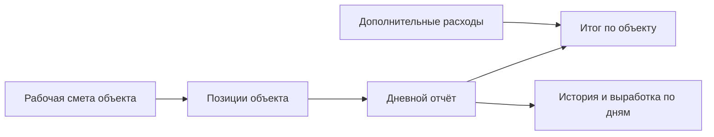
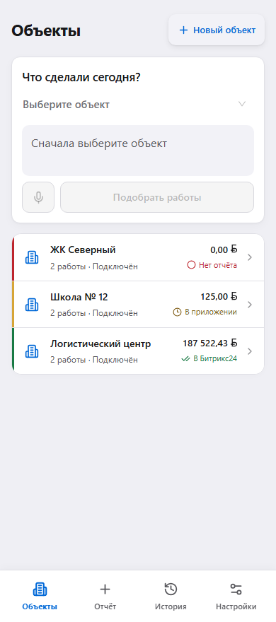
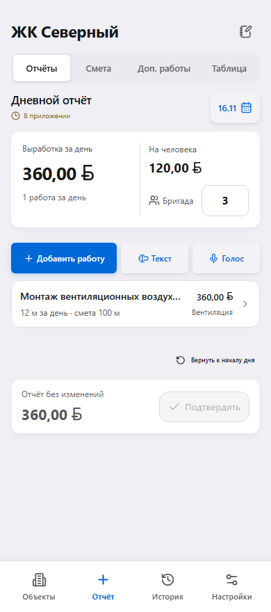
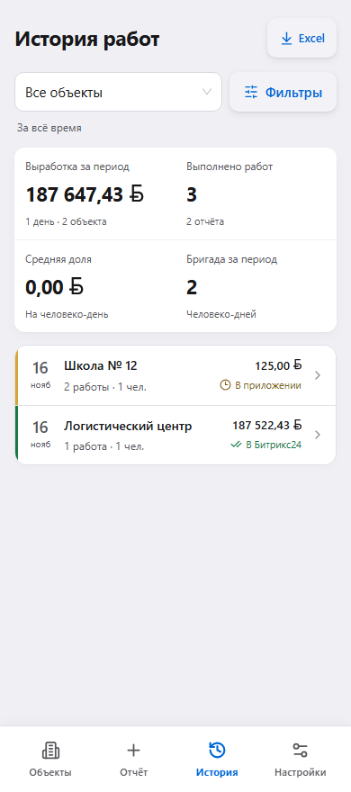
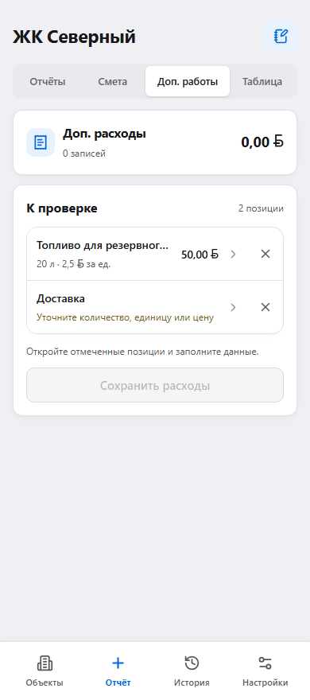
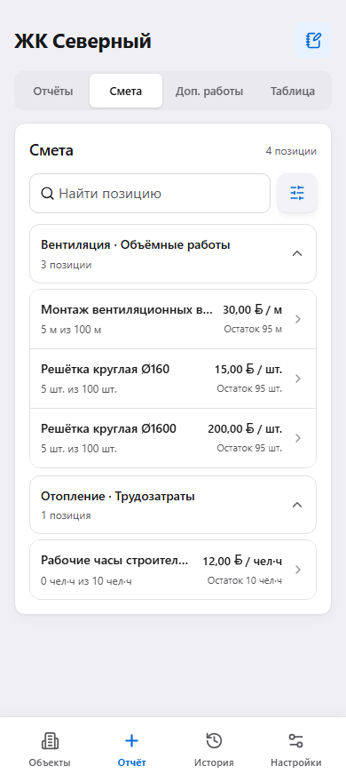
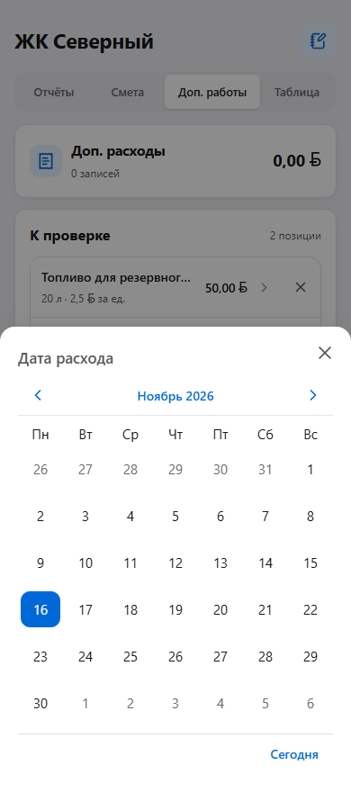

# M‑100 · Журнал работ

**Telegram Mini App для мастеров и администраторов строительных объектов.** В одном журнале собраны сметы, дневные отчёты, выработка, дополнительные расходы и примечания.

## Возможности

| Раздел            | Что видно в приложении                                                                                                                                                                |
| ----------------- | ------------------------------------------------------------------------------------------------------------------------------------------------------------------------------------- |
| **Объекты**       | Список объектов, состояние дневного отчёта, выработка за день и примечание к объекту.                                                                                                 |
| **Дневной отчёт** | Выполненные работы, объёмы, число работников, общая сумма и доля на человека. Работы можно добавить из сметы, текстом или голосом. У каждой работы есть примечание на выбранный день. |
| **Смета**         | Разделы работ, ставки, план, выполненный объём и остаток. Поиск и фильтры помогают находить позиции и видеть перерасход.                                                              |
| **Доп. работы**   | Отдельный учёт услуг, аренды, доставки и других расходов. Текст и диктовка превращаются в черновики с количеством и ставкой для проверки.                                             |
| **История**       | Отчёты по датам и объектам, календарь рабочих дней, выработка за период и диаграммы в Excel-отчёте.                                                                                   |
| **Битрикс24**     | Связь объекта с рабочей таблицей и состояние синхронизации. Дополнительные расходы учитываются на отдельном листе и входят в общий итог.                                              |

## От сметы к выработке

| Роль              | Рабочая область                                                                    |
| ----------------- | ---------------------------------------------------------------------------------- |
| **Мастер**        | Свои объекты, дневные отчёты, объёмы работ и дополнительные расходы.               |
| **Администратор** | Объекты мастеров, проверка отчётов и состояния синхронизации, управление доступом. |

## Галерея экранов

Скриншоты показывают приложение на демонстрационных данных.

|                                                 Объекты                                                 |                                                  Дневной отчёт                                                   |                                           История                                            |
| :-----------------------------------------------------------------------------------------------------: | :--------------------------------------------------------------------------------------------------------------: | :------------------------------------------------------------------------------------------: |
|  |  |  |

|                                          Доп. работы                                          |                                          Смета                                           |                                            Календарь                                             |
| :-------------------------------------------------------------------------------------------: | :--------------------------------------------------------------------------------------: | :----------------------------------------------------------------------------------------------: |
|  |  |  |
